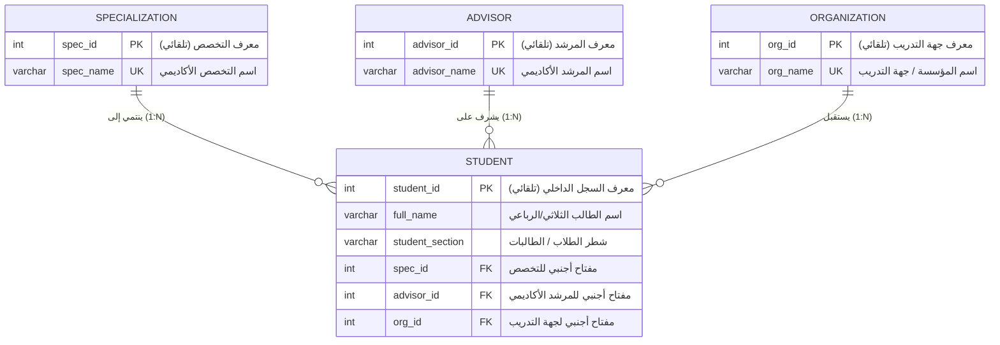

# مخطط الكيانات والعلاقات (ER Diagram) — نظام إدارة التدريب الميداني (COOP)

**مقرر برمجة الأعمال المتقدمة (MIS412) — كلية إدارة الأعمال بينبع — جامعة طيبة**

---

## 1. المخطط البصري (Entity-Relationship Diagram)

---

## 2. جدول تفاصيل الكيانات والسمات (Entities & Attributes)

### 2.1 جدول التخصصات الأكاديمية (`specialization`)
- **الهدف:** تخزين التخصصات المعتمدة في الكلية لمنع تكرار النصوص ولإتاحة التصفية وإحصائيات الطلاب.
- **المفتاح الأساسي (PK):** `spec_id` (توليد تلقائي `GENERATED ALWAYS AS IDENTITY`).
- **السمات الفريدة (UK):** `spec_name` (اسم التخصص فريد لمنع تكراره).

### 2.2 جدول المرشدين الأكاديميين (`advisor`)
- **الهدف:** إدارة بيانات أعضاء هيئة التدريس المشرفين على تدريب الطلاب.
- **المفتاح الأساسي (PK):** `advisor_id` (توليد تلقائي).
- **السمات الفريدة (UK):** `advisor_name` (اسم المرشد فريد).

### 2.3 جدول جهات ومؤسسات التدريب (`organization`)
- **الهدف:** حصر وتوحيد الشركات والمستشفيات والجهات الحكومية والخاصة التي يتدرب بها الطلاب.
- **المفتاح الأساسي (PK):** `org_id` (توليد تلقائي).
- **السمات الفريدة (UK):** `org_name` (اسم الجهة فريد).

### 2.4 جدول الطلاب (`student`)
- **الهدف:** السجل المركزي لبيانات الطلاب المتدربين وربطهم بالمراجع الثلاثة.
- **المفتاح الأساسي (PK):** `student_id` (معرف داخلي تلقائي التوليد).
- **المفاتيح الأجنبية (FK):**
  - `spec_id` يرتبط بجدول `specialization(spec_id)`.
  - `advisor_id` يرتبط بجدول `advisor(advisor_id)`.
  - `org_id` يرتبط بجدول `organization(org_id)`.
- **السمات الوصفية:**
  - `full_name`: اسم الطالب/ـة كاملاً.
  - `student_section`: الشطر كما ورد في الكلية ("طالب" / "طالبة").

---

## 3. العلاقات وقواعد التكامل المرجعي (Referential Integrity)

1. **علاقة التخصص بالطالب (1 : N):**
   - التخصص الواحد يمكن أن يسجل تحته عدة طلاب.
   - الطالب الواحد ينتمي إلى تخصص أكاديمي واحد فقط.
   - قيد الحذف: `ON DELETE RESTRICT` (يمنع حذف التخصص ما دام هناك طلاب مسجلين تحته).

2. **علاقة المرشد الأكاديمي بالطالب (1 : N):**
   - المرشد الواحد يمكن أن يشرف على عدة طلاب.
   - الطالب الواحد يشرف عليه مرشد أكاديمي واحد.
   - قيد الحذف: `ON DELETE RESTRICT` (يمنع حذف المرشد إذا كان يشرف على أي طالب).

3. **علاقة جهة التدريب بالطالب (1 : N):**
   - جهة التدريب الواحدة يمكن أن تستقبل عدة طلاب.
   - الطالب الواحد يتدرب في جهة واحدة خلال فترة التدريب.
   - قيد الحذف: `ON DELETE RESTRICT` (يمنع حذف جهة التدريب إذا كان هناك طلاب يتدربون فيها).

---

## 4. تحقيق الصيغ الطبيعية (Database Normalization - 3NF)

- **الصيغة الطبيعية الأولى (1NF):** جميع القيم في الحقول ذرية (Atomic)، ولا توجد مصفوفات أو حقول مكررة داخل السجل الواحد.
- **الصيغة الطبيعية الثانية (2NF):** محققة؛ حيث أن جميع الحقول غير المفتاحية تعتمد اعتماداً وظيفياً كاملاً على المفتاح الأساسي للجدول وليس على جزء منه.
- **الصيغة الطبيعية الثالثة (3NF):** محققة تماماً؛ تم التخلص من أي اعتماد متعدٍّ (Transitive Dependency)، حيث تم فصل أسماء التخصصات والمرشدين والجهات في جداول مستقلة وربطها بالمفاتيح فقط، مما يمنع شذوذ التعديل والحذف والإضافة (Anomalies).

